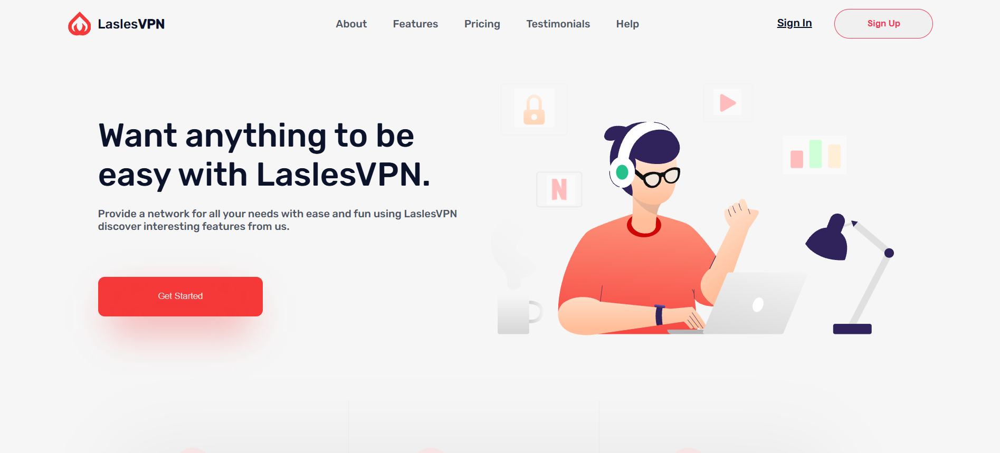

# 🌐 LaslesVPN — Landing Page

**Neo_Lasles_VPN** — мой первый Frontend-проект, разработанный в рамках профессиональной стажировки в **Neobis**.

Проект представляет собой адаптивный лендинг для сервиса LaslesVPN, предназначенный для презентации VPN-продукта, его возможностей, преимуществ и тарифных планов.

Основная задача проекта — получить практические навыки вёрстки веб-страниц, научиться правильно организовывать HTML-разметку и создавать стилизованные пользовательские интерфейсы с использованием CSS.

---

## 📸 Screenshots



---

## ✨ Features

- 🎨 **Clean UI** — аккуратный и современный дизайн.
- 📱 **Responsive Layout** — адаптация страницы под различные размеры экранов.
- 🧩 **Semantic HTML** — структурированная и семантическая HTML-разметка.
- 🎯 **BEM Methodology** — организация CSS-классов по методологии БЭМ.
- 💻 **Pure HTML & CSS** — реализация интерфейса без использования JavaScript и сторонних UI-библиотек.

---

## 🛠 Tech Stack

| Technology | Purpose |
|---|---|
| HTML5 | Структура и разметка страницы |
| CSS3 | Стилизация и оформление интерфейса |
| BEM | Методология именования CSS-классов |

---

## 🏗 Development

В процессе разработки я получил практический опыт:

- Создания веб-страниц с использованием HTML5.
- Стилизации элементов и блоков с помощью CSS3.
- Построения структуры страницы с учётом семантики HTML.
- Использования Flexbox для построения макетов.
- Применения методологии БЭМ для организации CSS-кода.
- Создания адаптивной вёрстки для разных устройств.
- Работы с изображениями, типографикой и отступами.

---

## 💻 Local Setup

### 1. Clone the repository

```bash
git clone <REPOSITORY_URL>
```

### 2. Run the project

Откройте файл `index.html` в браузере.

Никаких дополнительных зависимостей или установок не требуется.

---

## 👨‍💻 About the Project

**Developer:** Дастан Алмазбеков

**Role:** Frontend Developer

**Organization:** Neobis

**Project Type:** Landing Page

**Technologies:** HTML5, CSS3, BEM

Этот проект стал моей первой практической работой в рамках стажировки Neobis и помог заложить фундаментальные навыки Frontend-разработки.

---

## 🔗 Live Demo

🌐 **Project:** [View LaslesVPN Website](<https://dosymuss.github.io/neobis_front_lasles_VPN/>)

---

⭐ Thanks for checking out my project!
